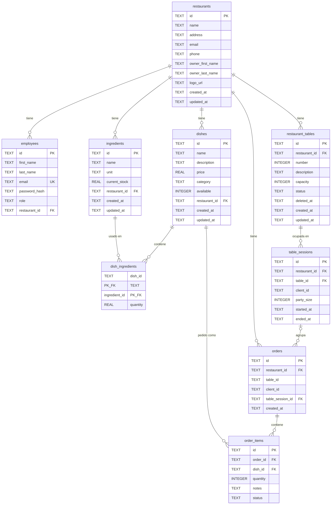

# Modelo de Datos

Esquema de la base de datos SQLite de Resttek.

---

## Diagrama Entidad-Relación

---

## Tablas

### `restaurants`

Almacena la información de los restaurantes.

| Columna | Tipo | Nullable | Descripción |
| --- | --- | --- | --- |
| `id` | TEXT | No | UUID, clave primaria |
| `name` | TEXT | No | Nombre del restaurante |
| `address` | TEXT | No | Dirección |
| `email` | TEXT | No | Email de contacto |
| `phone` | TEXT | No | Teléfono |
| `owner_first_name` | TEXT | No | Nombre del propietario |
| `owner_last_name` | TEXT | No | Apellido del propietario |
| `logo_url` | TEXT | Sí | URL del logo |
| `created_at` | TEXT | No | Fecha de creación (ISO 8601) |
| `updated_at` | TEXT | No | Fecha de última actualización |

---

### `employees`

Almacena **todos** los usuarios del sistema, incluidos los clientes: no hay tabla de clientes aparte. Un cliente es una fila con `role = 'cliente'` y `restaurant_id` a null.

| Columna | Tipo | Nullable | Descripción |
| --- | --- | --- | --- |
| `id` | TEXT | No | UUID, clave primaria |
| `first_name` | TEXT | No | Nombre |
| `last_name` | TEXT | No | Apellido |
| `email` | TEXT | No | Email (único) |
| `password_hash` | TEXT | No | Hash bcrypt de la contraseña |
| `role` | TEXT | No | Rol: admin, manager, camarero, cocinero, cliente |
| `restaurant_id` | TEXT | Sí | FK → `restaurants.id` (null para admin y cliente) |

**Restricciones:**

- `email` es UNIQUE.
- `restaurant_id` es FK a `restaurants.id`.

---

### `ingredients`

Ingredientes disponibles en cada restaurante.

| Columna | Tipo | Nullable | Descripción |
| --- | --- | --- | --- |
| `id` | TEXT | No | UUID, clave primaria |
| `name` | TEXT | No | Nombre del ingrediente |
| `unit` | TEXT | No | Unidad: kg, g, l, ml, unidad |
| `current_stock` | REAL | No | Stock actual (default: 0) |
| `restaurant_id` | TEXT | No | FK → `restaurants.id` |
| `created_at` | TEXT | No | Fecha de creación |
| `updated_at` | TEXT | No | Fecha de última actualización |

---

### `dishes`

Platos de la carta de cada restaurante.

| Columna | Tipo | Nullable | Descripción |
| --- | --- | --- | --- |
| `id` | TEXT | No | UUID, clave primaria |
| `name` | TEXT | No | Nombre del plato |
| `description` | TEXT | Sí | Descripción |
| `price` | REAL | No | Precio en euros |
| `category` | TEXT | No | Categoría: entrante, principal, postre, bebida |
| `available` | INTEGER | No | Disponibilidad: 1 = sí, 0 = no (default: 1) |
| `restaurant_id` | TEXT | No | FK → `restaurants.id` |
| `created_at` | TEXT | No | Fecha de creación |
| `updated_at` | TEXT | No | Fecha de última actualización |

---

### `dish_ingredients`

Relación muchos-a-muchos entre platos e ingredientes.

| Columna | Tipo | Nullable | Descripción |
| --- | --- | --- | --- |
| `dish_id` | TEXT | No | FK → `dishes.id` (PK compuesta) |
| `ingredient_id` | TEXT | No | FK → `ingredients.id` (PK compuesta) |
| `quantity` | REAL | No | Cantidad del ingrediente necesaria |

**Restricciones:**

- PK compuesta: (`dish_id`, `ingredient_id`).
- FK a `dishes.id` **con** `ON DELETE CASCADE`: al borrar un plato desaparecen sus ingredientes asociados.
- FK a `ingredients.id` **sin** cascada.

---

### `orders`

Pedidos de los clientes.

| Columna | Tipo | Nullable | Descripción |
| --- | --- | --- | --- |
| `id` | TEXT | No | UUID, clave primaria |
| `restaurant_id` | TEXT | No | FK → `restaurants.id` |
| `table_id` | TEXT | Sí | Identificador de mesa (opcional, sin FK) |
| `client_id` | TEXT | Sí | ID del cliente (opcional) |
| `table_session_id` | TEXT | Sí | FK → `table_sessions.id`. Null en pedidos anteriores a las ocupaciones |
| `created_at` | TEXT | No | Fecha de creación |

**Notas:**

- Los pedidos de cliente nuevos llevan siempre `table_session_id` de una ocupación propia y abierta, y `table_id` coincide con la mesa de esa ocupación. Los pedidos antiguos sin ocupación siguen siendo consultables y procesables, y no se asocian a ninguna visita.
- `table_session_id` se añadió a bases existentes con `ALTER TABLE` (ver [Evolución del esquema](#evolución-del-esquema)). Tiene índice `idx_orders_table_session`.
- En lectura, la API añade dos campos calculados: `tableNumber` (número de la mesa, si se conoce) y `tableSessionEndedAt` (cierre de la ocupación, para etiquetar pedidos de visitas ya cerradas).

---

### `restaurant_tables`

Mesas de cada restaurante.

| Columna | Tipo | Nullable | Descripción |
| --- | --- | --- | --- |
| `id` | TEXT | No | UUID, clave primaria |
| `restaurant_id` | TEXT | No | FK → `restaurants.id` |
| `number` | INTEGER | No | Número visible de la mesa, entero > 0 |
| `description` | TEXT | No | Descripción libre; admite cadena vacía (default: `''`) |
| `capacity` | INTEGER | No | Comensales que admite, entero > 0 |
| `status` | TEXT | No | Estado: libre, ocupada, reservada |
| `deleted_at` | TEXT | Sí | Fecha del borrado lógico; null si la mesa está activa |
| `created_at` | TEXT | No | Fecha de creación |
| `updated_at` | TEXT | No | Fecha de última actualización |

**Restricciones:**

- `CHECK` en `number > 0`, `capacity > 0` y `status IN ('libre', 'ocupada', 'reservada')`.
- Índice único parcial `idx_tables_active_number` en (`restaurant_id`, `number`) `WHERE deleted_at IS NULL`. El número es único entre las mesas activas de un restaurante; tras borrar una mesa se puede crear otra con el mismo número, que recibe un id nuevo.
- **Borrado lógico**: borrar una mesa rellena `deleted_at` y cierra su ocupación abierta, sin eliminar sesiones, pedidos ni ítems. Las mesas borradas no aparecen en listados ni en disponibilidad, y la API responde 404 al consultarlas.
- La API añade en lectura `activeSessionId`: el id de la ocupación abierta o null.

---

### `table_sessions`

Ocupaciones (visitas) de una mesa. Separan los pedidos de visitas distintas a la misma mesa.

| Columna | Tipo | Nullable | Descripción |
| --- | --- | --- | --- |
| `id` | TEXT | No | UUID, clave primaria |
| `restaurant_id` | TEXT | No | FK → `restaurants.id` |
| `table_id` | TEXT | No | FK → `restaurant_tables.id` |
| `client_id` | TEXT | Sí | Cliente titular; null en ocupaciones manuales hechas por personal |
| `party_size` | INTEGER | Sí | Número de comensales, > 0. Lo indica el cliente; null en ocupaciones manuales |
| `started_at` | TEXT | No | Inicio de la ocupación |
| `ended_at` | TEXT | Sí | Cierre de la ocupación; null mientras sigue abierta |

**Restricciones:**

- Índice único parcial `idx_table_sessions_open_table` en `table_id` `WHERE ended_at IS NULL`: una mesa tiene como máximo una ocupación abierta.
- Índice único parcial `idx_table_sessions_open_client` en (`restaurant_id`, `client_id`) `WHERE ended_at IS NULL AND client_id IS NOT NULL`: un cliente tiene como máximo una ocupación abierta por restaurante. Puede tener otras abiertas en restaurantes distintos.
- Las sesiones nunca se borran: al liberar, reservar o borrar la mesa solo se rellena `ended_at`.

**Ciclo de vida** (estado de la mesa → efecto sobre la ocupación):

| Transición | Quién | Efecto |
| --- | --- | --- |
| `libre` → `ocupada` al confirmar mesa | cliente | Abre sesión con `client_id` y `party_size`. Solo mesas libres con `capacity >= party_size` |
| `libre`/`reservada` → `ocupada` | personal | Abre sesión manual, sin cliente ni grupo |
| `ocupada` → `ocupada` | personal | Sin efecto: no abre otra visita |
| `ocupada` → `libre`/`reservada` | personal | Cierra la sesión. Los pedidos pendientes no se cancelan ni se entregan |
| borrado de la mesa | admin | Cierra la sesión y borra la mesa lógicamente |

La ocupación y los cambios de estado se hacen en una transacción (`Database.transaction()`), de modo que la mesa y su sesión cambian juntas o no cambian. No se reduce `capacity` por debajo del `party_size` de una ocupación de cliente abierta.

---

### `order_items`

Líneas de pedido. Cada ítem es un plato con cantidad y estado.

| Columna | Tipo | Nullable | Descripción |
| --- | --- | --- | --- |
| `id` | TEXT | No | UUID, clave primaria |
| `order_id` | TEXT | No | FK → `orders.id` |
| `dish_id` | TEXT | No | FK → `dishes.id` |
| `quantity` | INTEGER | No | Cantidad pedida |
| `notes` | TEXT | Sí | Notas del cliente (ej: "sin gluten") |
| `status` | TEXT | No | Estado: pendiente, preparando, listo, entregado |

**Restricciones:**

- ON DELETE CASCADE desde `orders.id`.

---

## Relaciones

| Relación | Tipo | Descripción |
| --- | --- | --- |
| Restaurant → Employees | 1:N | Un restaurante tiene muchos empleados |
| Restaurant → Ingredients | 1:N | Un restaurante tiene muchos ingredientes |
| Restaurant → Dishes | 1:N | Un restaurante tiene muchos platos |
| Restaurant → Orders | 1:N | Un restaurante tiene muchos pedidos |
| Restaurant → RestaurantTables | 1:N | Un restaurante tiene muchas mesas |
| RestaurantTable → TableSessions | 1:N | Una mesa tiene muchas ocupaciones a lo largo del tiempo, como máximo una abierta |
| TableSession → Orders | 1:N | Una ocupación agrupa los pedidos de esa visita; los pedidos antiguos no tienen ocupación |
| Dish ↔ Ingredient | N:M | Un plato usa varios ingredientes (via `dish_ingredients`) |
| Order → OrderItems | 1:N | Un pedido tiene varios ítems |
| Dish → OrderItems | 1:N | Un plato puede estar en varios ítems de pedido |

---

## Notas Técnicas

- **IDs**: Todos son UUID v4 generados con `crypto.randomUUID()`. Excepción: el script de seed usa los identificadores fijos `rest-1` y `rest-2` para los restaurantes de prueba.
- **Fechas**: Almacenadas como TEXT en formato ISO 8601 (`new Date().toISOString()`).
- **Booleanos**: SQLite no tiene tipo BOOLEAN; se usa INTEGER (0 = false, 1 = true).
- **Nomenclatura**: las columnas son `snake_case` y las propiedades TypeScript `camelCase`. La conversión se hace con alias en el propio SQL (`owner_first_name as ownerFirstName`).
- **Migraciones**: Las tablas se crean automáticamente en `Database.initialize()` con `CREATE TABLE IF NOT EXISTS`.
- **Sin migrations framework**: No se usa un sistema de migraciones formal. Los cambios de esquema se hacen modificando `runInitialMigrations()`. Como solo se ejecuta `CREATE TABLE IF NOT EXISTS`, **añadir una columna a una tabla existente no afecta por sí solo a una base de datos ya creada**: hay que añadirla explícitamente, como se describe abajo.
- **IDs del seed de mesas**: las mesas y la ocupación manual del seed usan ids fijos con forma de UUID, para que repetir `npm run seed` no las duplique.

### Evolución del esquema

`runInitialMigrations()` usa `addColumnIfMissing()` para añadir columnas a tablas existentes sin borrar datos: consulta `PRAGMA table_info(<tabla>)` y solo ejecuta `ALTER TABLE ... ADD COLUMN` si la columna no existe. Así se añadió `orders.table_session_id`. Inicializar varias veces es seguro y no hace falta borrar `packages/api/resttek.db`. Las tablas nuevas (`restaurant_tables`, `table_sessions`) y sus índices se crean con `IF NOT EXISTS`.